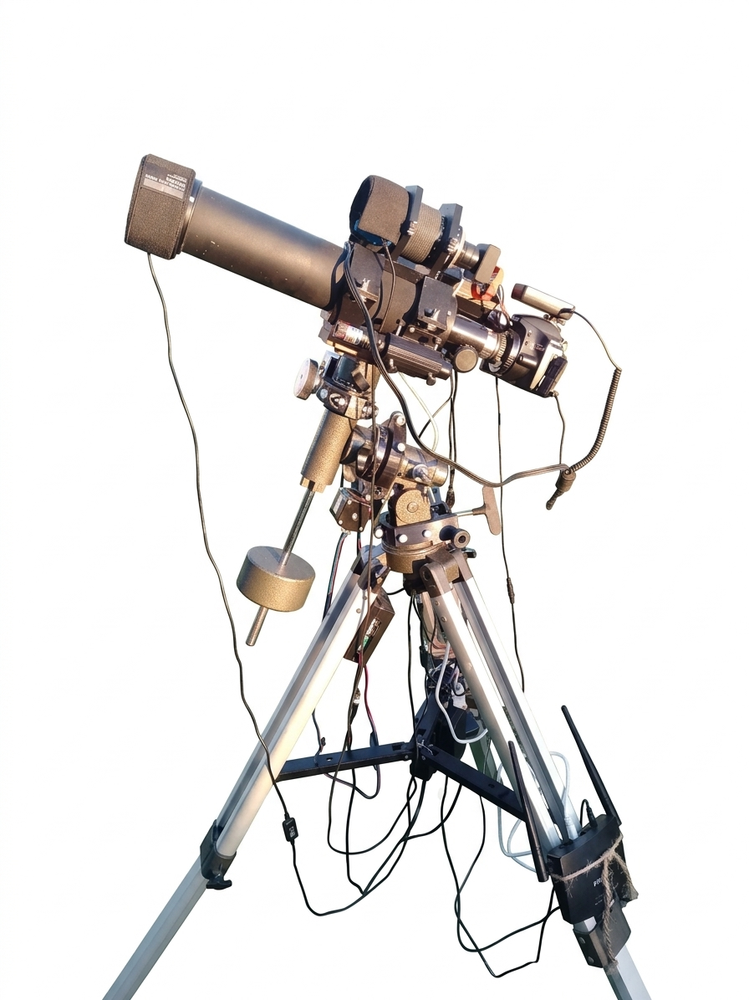
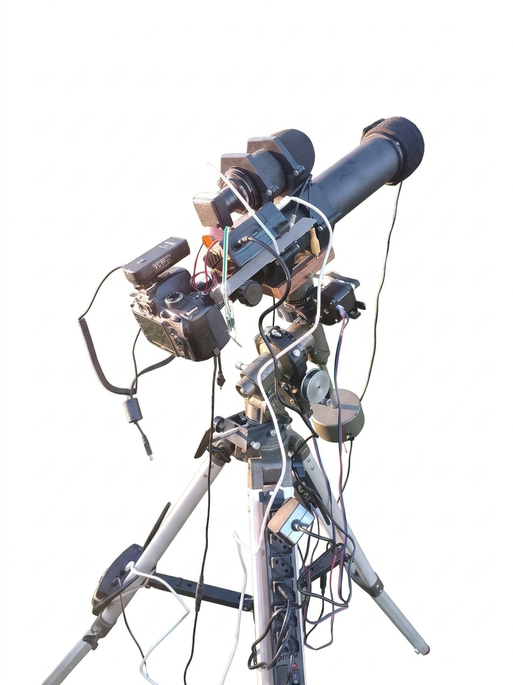

# Computer Assisted Design and mechanical build
 

## ⚠️ Página em construção ⚠️

---

## STLs
Nesta seção vou linkar os arquivos STL das peças que criei para este projeto e a explicação de como usar cada uma: suportes para rolamentação dos fusos infinitos, buchas internas para rolamentação dos eixos principais (RA e dec), anéis do telescópio, engate rápido padrão vixen, suportes para laser, defletores internos do telescópio, case da câmera de guiagem, etc.

## Lista de materiais

### Óptica
Lista de materiais e resumo da construção do telescópio refrator dubleto 70mm f7

### Mecânica
Lista de peças mecânicas usadas na rolamentação e motorização da montagem

## Links relevantes:
### Refractor Baffling
https://www.academia.edu/42708675/Refractor_Baffling_V8_3_2022

   &nbsp;&nbsp;&nbsp;&nbsp; 

