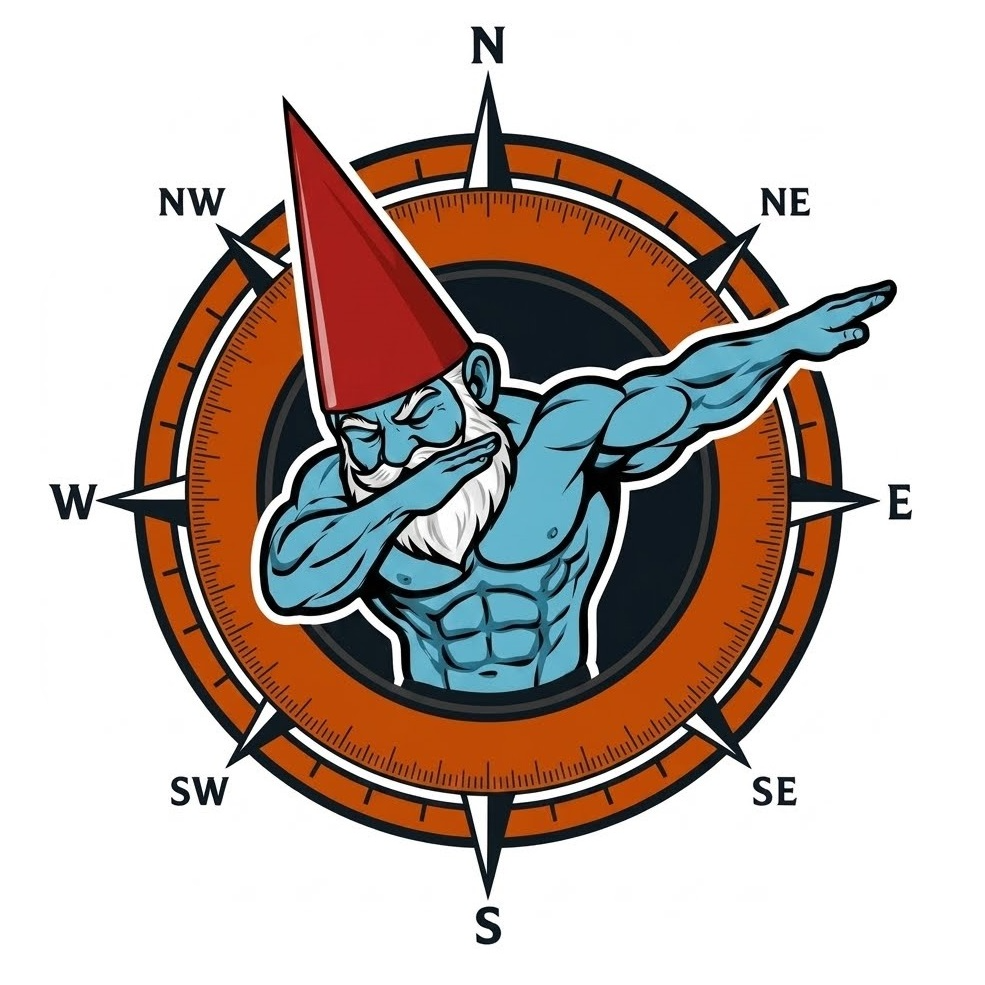

# Gnomonster: Open source smart telescope 

[**English**](#-english) • [**Português**](#-português)

---

### English

**Gnomon:** From Greek, meaning sundial — a rudimentary tool for tracking celestial bodies.  
**Ster:** A Germanic suffix indicating someone who performs an action. Thus, *Gnomonster* means "one who makes a gnomon."

Gnomonster is a low-cost, open-source instrumentation ecosystem for amateur astronomy and astrophotography, designed to automate analog astronomical hardware and overcome mechanical imperfections in the mount.

The project combines precision mechanical engineering (CAD/3D printing), embedded Linux Kernel compilation on the Raspberry Pi 5, microcontroller firmware automation, and real-time video pipelines to enable deep-sky astrophotography with GoTo, responsive guiding, and remote control via Wi-Fi.

---

### 🏗️ System Architecture & Technical Contributions

#### 1. Mechanical & Optical Engineering (CAD & Prototyping)
To mitigate axial play, friction, and internal reflections that degrade the signal-to-noise ratio (SNR) of images, the project involved custom mechanical development:
* **EQ3 Mount Restoration:** Modeling and machining/3D printing of internal bushings and custom brackets to couple bearings onto the worm gears, eliminating mechanical *backlash*.
* **Internal Baffles (OTA):** Computational modeling and 3D printing (PLA) of conical internal baffles for the optical tube (70mm f/7 doublet refractor), optimized to trap stray reflections and maximize stellar contrast (empirical proof documented in the repository).
* **Structural Mounts:** Tube rings for the main OTA and guide scope featuring an integrated quick-release system for the *Vixen* dovetail standard and a laser alignment shoe.

#### 2. Embedded Linux & Low-Level Research (Raspberry Pi 5 & VEYE MIPI)
Migrating to the Raspberry Pi 5 architecture introduced hardware compatibility barriers due to drastic changes in the camera subsystem (transition to the *RP1* subsystem and *libcamera*).
* **Kernel Customization:** Conducted  technical research to adapt the IMX462 sensor driver to the Raspberry Pi 5.
* **Device Tree Compilation (.dtbo):** Manual compilation and injection of the device tree overlay (`dtbo`) directly into the boot partition of **AstroArch (Arch Linux ARM)**, allowing the MIPI-CSI interface to natively recognize the industrial vision module. *(Step-by-step instructions and patched binaries are available in the `/software` folder)*.

#### 3. Real-Time Video Pipeline (Shell Script / GStreamer / FFmpeg)
The native drivers provided by the manufacturer were not integrated into the Linux astronomy ecosystem. The solution was to develop a **Shell (Bash)** script that creates a real-time logical data bridge:
* **Ingestion:** Captures the raw digital stream coming from the MIPI-CSI bus via **GStreamer**.
* **Dynamic Transcoding:** The feed is tuned via command-line **FFmpeg**, allowing precise control over the sensor's continuous exposure time (frames up to 1s) to mitigate thermal noise.
* **V4L2 Emulation:** Injects the processed stream into a simulated loopback video device (`/dev/videoX` via Video4Linux2), making the industrial sensor feed 100% readable and compatible with the autonomous guiding module in **Ekos**.

#### 4. Astronomical Firmware Orchestration (OnStepX)
* Integration of the **FYSETC E4** esp32 based 3d printer controller board using the open-source **OnStepX** firmware.
* Fine calibration of steps per arcsecond based on the mechanical gear reduction of the EQ3 worm wheels, enabling responsive micro-correction commands sent via the **INDI** distributed network socket protocol.

---

### 📉 Economic Feasibility (Prices in Brazil as of November 2026)

The Gnomonster project was developed under the philosophy of open computing and breaking *vendor lock-in*. By extracting the maximum potential from generic off-the-shelf hardware through Embedded Linux, firmware automation, and custom pipelines, the system delivers **higher computational power and equivalent features for a fraction of the local commercial cost**:

| Component / Feature | Proprietary Commercial Ecosystem (ZWO / Sky-Watcher) | Gnomonster Solution (Open Architecture) |
| :--- | :--- | :--- |
| **Core Computing** | R$ 9,439.00 [ZWO ASIAIR Plus 4GB RAM] | R$ 1,044.90 [Raspberry Pi 5 8GB RAM] |
| **Storage** | (256GB proprietary soldered eMMC) | R$ 250.00 [128GB NVMe SSD + NVMe HAT] |
| **Guide Sensor** | R$ 2,100.00 [Equivalent ZWO IMX462 Camera] | R$ 498.00 [VEYE MIPI IMX462 Module] |
| **Controller Board** | (Included in the GOTO mount internal motherboard) | R$ 280.00 [FYSETC E4 Board (OnStepX)] |
| **Stepper Motors** | (Included in factory-sealed motor blocks) | R$ 160.00 [Pair of NEMA 17 400-step Motors] |
| **Structure / Mount** | R$ 6,599.00 [EQ3 Pro GOTO Equatorial Mount] | R$ 500.00 [Used Generic EQ3 Mount] |
| **Licensing** | Locked Proprietary (ZWO devices only) | 100% Open-Source (INDI Core Protocol) |
| **TOTAL COST** | **~ R$ 18,138.00** | **~ R$ 2,732.90** |

#### 🚀 Engineering Highlights:
* **~85% Cost Reduction:** Assembling the open-source ecosystem generates real savings of over R$ 15,000.00 compared to locally priced proprietary hardware.
* **Superior Computational Performance:** The next-generation ARM Cortex-A76 processor (RPi5) with 8GB of RAM runs the real-time GStreamer and FFmpeg pipeline without stuttering, outperforming commercial hubs based on legacy microarchitectures.
* **Modular System, Maximum Compatibility:** The INDI ecosystem provides drivers for a wide range of equipment—DSLR cameras, webcams, dedicated astronomy cameras, focusers, filter wheels, and mounts (it does not necessarily have to be used only with OnStep).

---

### 🧰 Upstream Projects & References
To avoid unnecessary code replication, this repository consumes and integrates the following stable open-source community solutions. In (`/software/`), we maintain only tutorials, scripts, and examples focused on integrating these systems. For installation and setup of these resources, please visit the original repositories:
* [OnStepX](https://onstep.groups.io/g/main/wiki/32747) - Circuit assembly tutorial and OnStepX firmware installation on the FYSETC E4 board (ESP32-based 3D printer controller).
* [AstroArch Linux](https://github.com/devDucks/astroarch) - High-performance embedded Linux distribution based on Arch Linux for ARM64.
* [VEYE Imaging RPi Camera](https://github.com/veyeimaging/raspberrypi_v4l2) - Official VEYE repository for V4L2. You will use this repository to fetch the source code files for compilation, while following the adapted compilation guide in this repos' (`/software/readme.md`) to build and install the VEYE module driver on the RPi5 running AstroArch.

---

### 📄 License
This project is under a Custom License - see the [LICENSE](LICENSE) file for details.

[⬆️ Back to top](#gnomonster-open-source-smart-telescope-)

---

### 🇧🇷 Português

**Gnomon:** do grego significa relógio solar, uma ferramenta rudimentar para acompanhamento dos astros.  
**Ster:** sufixo germânico que indica quem faz alguma coisa. De forma que *Gnomonster* é "quem faz gnomon".

O Gnomonster é um ecossistema de instrumentação para astronomia e astrofotografia amadora de baixo custo e código aberto voltado para automatizar hardware astronômico analógico e contornar imperfeições na mecânica da montagem.

O projeto combina CAD/impressão 3D, compilação do Kernel Linux embarcado no Raspberry Pi 5, automação de firmware em microcontroladores e pipelines de vídeo em tempo real para viabilizar astrofotografia de céu profundo com GoTo, guiagem responsiva e controle remoto via Wi-Fi.

---

### 🏗️ Arquitetura do Sistema e Contribuições Técnicas

#### 1. Engenharia Mecânica e Óptica (CAD & Prototipagem)
Para mitigar folgas axiais, atritos e reflexões internas que destroem a relação sinal-ruído das imagens, o projeto envolveu desenvolvimento mecânico sob medida:
* **Restauração da Montagem EQ3:** Modelagem e usinagem/impressão de buchas internas e suportes customizados para acoplamento de rolamentos nos fusos infinitos, eliminando o *backlash* mecânico.
* **Defletores Internos (OTA):** Modelagem computacional e impressão 3D (PLA) de defletores internos cônicos para o tubo óptico (refrator dubleto 70mm f/7), otimizados para reter reflexões espúrias e maximizar o contraste estelar (comprovação empírica documentada no repositório).
* **Suportes Estruturais:** Anéis de fixação para o tubo principal e luneta de guiagem com sistema de engate rápido integrado para o padrão de trilhos *Vixen* e sapata para alinhamento laser.

#### 2. Linux Embarcado e Pesquisa de Baixo Nível (Raspberry Pi 5 & VEYE MIPI)
A migração para a arquitetura do Raspberry Pi 5 introduziu barreiras de compatibilidade de hardware devido às mudanças drásticas no subsistema de câmera (mudança para subsistema *RP1* e *libcamera*).
* **Customização de Kernel:** Realização de engenharia reversa e pesquisa bibliográfica avançada baseada nos repositórios da VEYE para adaptar o driver do sensor IMX462 ao Raspberry Pi 5.
* **Compilação de Device Trees (.dtbo):** Processo manual de compilação e injeção do overlay de árvore de dispositivos (`dtbo`) diretamente na partição de boot do **AstroArch (Arch Linux ARM)**, permitindo que a interface MIPI-CSI reconhecesse nativamente o módulo de visão industrial. *(O passo a passo e os binários corrigidos estão disponíveis na pasta `/software`)*.

#### 3. Pipeline de Vídeo em Tempo Real (Shell Script / GStreamer / FFmpeg)
Os drivers nativos fornecidos pelo fabricante não eram integrados ao ecossistema astronômico Linux. A solução foi desenvolver um script em **Shell (Bash)** que cria uma ponte lógica de dados em tempo real:
* **Ingestão:** Captura o fluxo digital bruto vindo do barramento MIPI-CSI via **GStreamer**.
* **Transcodificação Dinâmica:** O feed é tunado por comandos **FFmpeg** em linha de comando, permitindo o controle exato do tempo de exposição contínua do sensor (frames de até 1s) para mitigar ruidos térmicos.
* **Emulação V4L2:** Injeta o fluxo processado em um dispositivo de vídeo em loopback simulado (`/dev/videoX` via Video4Linux2), tornando o feed do sensor industrial 100% legível e compatível com o módulo de guiagem autônoma do **Ekos (PHD2 Engine)**.

### 4. Orquestração de Firmware Astronômico (OnStepX)
* Integração da placa controladora de motores de passo **FYSETC E4** ao ecossistema por meio do firmware open-source **OnStepX**.
* Calibração fina dos passos por arcosegundo baseada na redução mecânica das coroas da EQ3, permitindo comandos responsivos de micro-correções enviados via protocolo de sockets de rede distribuída **INDI**.

---

## 📉 Viabilidade Econômica (Preços Praticados no Brasil em novembro de 2026)

O projeto Gnomonster foi desenvolvido sob a filosofia de computação aberta e quebra de *vendor lock-in*. Ao extrair o potencial máximo de hardwares genéricos de prateleira por meio de Linux Embarcado, automação de firmware e pipelines customizadas, o sistema entrega **maior poder computacional e recursos equivalentes por uma fração do custo comercial nacionalizado**:

| Componente / Recurso    | Ecossistema Comercial Proprietário (ZWO / Sky-Watcher)| Solução Gnomonster (Arquitetura Aberta)   |
| :---------------------- | :---------------------------------------------------- | :-------------------------------------    |
| **Computação Central**  | R$ 9.439,00 [ZWO ASIAIR Plus 4GB RAM]                 | R$ 1.044,90 [Raspberry Pi 5 8GB RAM]      |
| **Armazenamento**       | (256GB eMMC proprietário soldado)                     | R$   250,00 [SSD NVMe 128GB + NVMe HAT]   |
| **Sensor de Guiagem**   | R$ 2.100,00 [Câmera ZWO Equivalente IMX462]           | R$   498,00 [Módulo VEYE MIPI IMX462]     |
| **Placa Controladora**  | (Inclusa na placa-mãe interna da montagem GOTO)       | R$   280,00 [Placa FYSETC E4 (OnStepX)]   |
| **Motores de Passo**    | (Inclusos nos blocos selados de fábrica)              | R$   160,00 [Par de Motores NEMA 17 400P] |
| **Estrutura / Montagem**| R$ 6.599,00 [Montagem Equatorial EQ3 Pro GOTO]        | R$   500,00 [Montagem EQ3 genérica Usada] |
| **Licenciamento**       | Proprietário Trancado (Apenas dispositivos ZWO)       | 100% Open-Source (INDI Core Protocol)     |
| **CUSTO TOTAL**         | **~ R$ 18.138,00**                                    | **~ R$ 2.732,90**                         |

### 🚀 Diferencial de Engenharia:
* **Redução de Custo de ~85%:** A montagem do ecossistema open-source gerara uma economia real de mais de R$ 15.000,00 em comparação ao hardware proprietário nacionalizado.
* **Performance Computacional Superior:** O processador ARM Cortex-A76 (RPi5) de última geração com 8GB de RAM executa o pipeline em tempo real via GStreamer e FFmpeg sem qualquer travamento, superando os hubs comerciais baseados em microarquiteturas legadas.
* **Sistema modular, compatibilidade máxima** O ecossistema INDI tem drivers para os mais diversos equipamentos, câmeras DSLR, webcams, astronômicas, focalizadores, roda de filtros, montagem (não precisa ser necessariamente usado apenas com OnStep).
---

## 🧰 Referências a Projetos Upstream Utilizados
Para evitar a replicação desnecessária de código, este repositório consome e integra as seguintes soluções estáveis da comunidade open-source, em (`/software/`) vamos manter apenas tutorial, scripts e exemplos voltados à integração desses sistemas. Para instalação e configuração desses recursos visite os reposiórios originais:
* [OnStepX](https://onstep.groups.io/g/main/wiki/32747) - Tutorial de montagem do circuito e instalação do firmware OnStepX na placa Fysetc E4 (controladora de impressora 3d baseada em esp32). 
* [Astroarch Linux](https://github.com/devDucks/astroarch) - Distribuição Linux embarcada de alta performance baseada em Arch Linux para ARM64.
* [VEYE Imaging RPi Camera](https://github.com/veyeimaging/raspberrypi_v4l2) - Repositório oficial da Veye para v4l2 - Voce vai usar este repositório para pegar os arquivos com o código fonte para compilar, mas vai seguir o tutorial de compilação em (`/software/readme.md`), uma versão adaptada para compilar e instalar o driver do módulo Veye no RPI5 com Astroarch.
* 

## 📄 Licença
Este projeto está sob a licença Própria - veja o arquivo [LICENSE](LICENSE) para detalhes.
