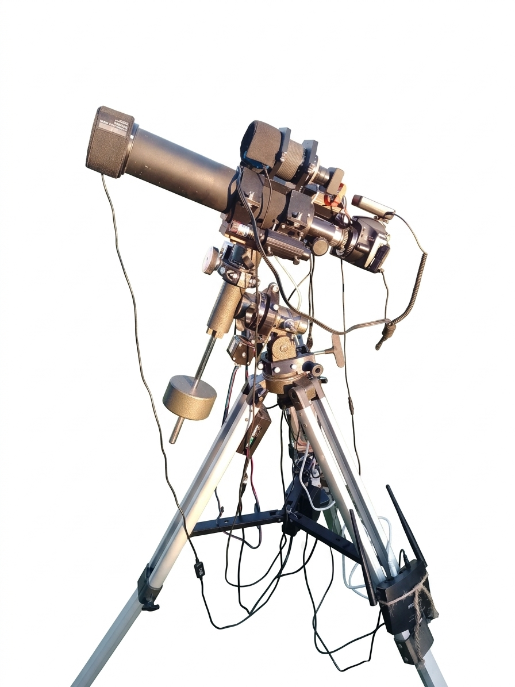
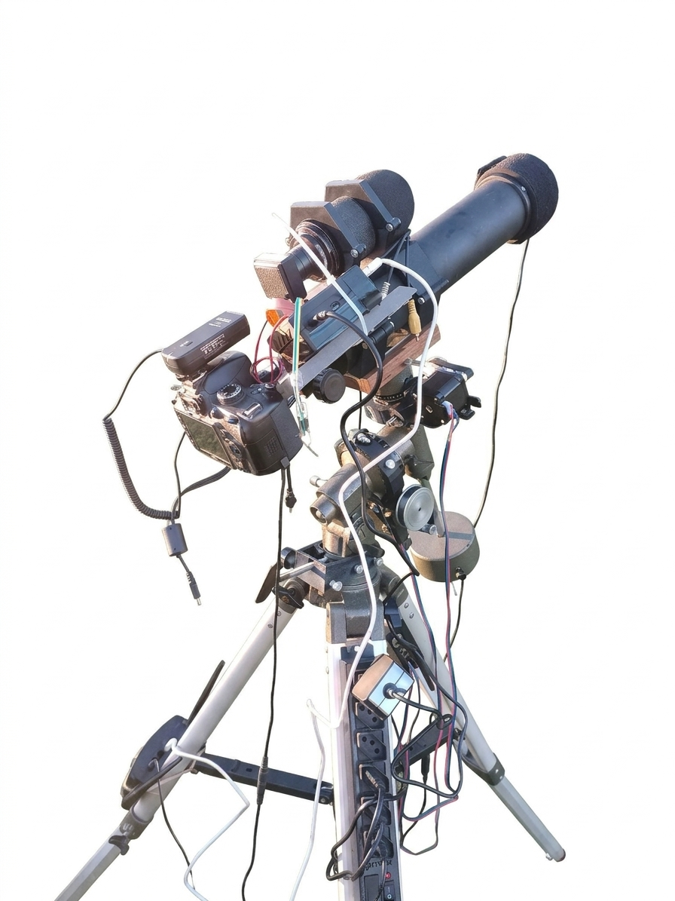
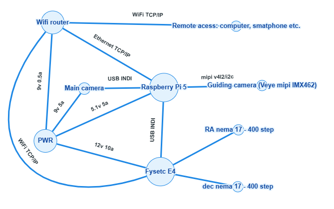

---

# Hardware: Bill of Materials and System Architecture

   &nbsp;&nbsp;&nbsp;&nbsp; 

---

## Bill of Materials (BOM)
This section focuses on the electronic hardware and their interconnections. The mechanical parts (pulleys, motor brackets, mount bearings, quick-release dovetail) and optics are covered in the `CAD` directory. Camera driver installation and data pipelines are detailed in the `software` directory.

My goal with this setup is to achieve responsive autoguiding while keeping costs as low as possible. There is still plenty of room for improvement, and I am gradually approaching sub-arcsecond guiding resolution.

This Bill of Materials represents the bare minimum skeleton required to achieve this. OnStep also supports many additional features with extra sensors and actuators that can be integrated into Ekos (the observatory control suite on the RPi) using INDI drivers. However, the current focus of the project is strictly on improving autoguiding—where the current bottleneck lies in the optics or the mount's mechanics (known limitations) rather than in the electronics or software (which are running smoothly).

Please read the official documentation for each item in their respective repositories. Peripheral hardware such as dew heaters, heatsinks, adapters, power plugs, etc., are not listed here and may be required.

* **[Raspberry Pi 5]** 5.1V 5A
* **[VEYE MIPI IMX462 Module]** 3.3–5V (powered via RPi GPIO)
* **[FYSETC E4 Board (OnStepX)]** 12V 10A
* **[Pair of NEMA 17 400-Step Motors]** (powered via FYSETC E4)
* **[Wifi router]**

## Network Configuration

### Router
Configure the router in **repeater mode** to extend your home modem's Wi-Fi signal. This allows you to access your astrophotography rig and the internet simultaneously on the same local network.

### OnStep
Set it to **Station Mode** with a static IP address and connect it to the router. If you don't have a USB cable handy, this static IP also enables OnStep to communicate with Ekos over the network via the INDI driver.

### Raspberry Pi 5
* Connect the RPi to the router using an **Ethernet cable**. 
* Connect the OnStep controller to the Raspberry Pi via a **USB cable**.
* The VEYE IMX462 sensor module connects to the RPi 5 using a ribbon cable via the **MIPI CSI-2** interface and draws 3.3–5V power directly from the RPi GPIO pins *(check the official VEYE documentation for exact wiring details)*.
* The main imaging camera connects to the Raspberry Pi via USB or MIPI ribbon cable (the RPi 5 features two MIPI slots). The primary capture camera is not included in this project's cost breakdown, as the INDI ecosystem supports a wide range of commercial gear. Currently (11/2026), I am using a **Nikon D3200 DSLR**.

### Local Network Remote Access
Connect your remote device (smartphone or PC) to your router and access AstroArch via **VNC**. AstroArch comes with VNC and FTP servers enabled by default—check the distro's documentation for connection details.

While VNC gets the job done initially, I strongly recommend switching to **RustDesk** for better performance and responsiveness.

---
---

# Hardware: lista de materiais e arquitetura do sistema

   &nbsp;&nbsp;&nbsp;&nbsp; 

---

## Lista de materiais
Neste trecho o foco fica nos equipamentos eletrônicos e a conexão entre eles. A parte mecânica (Polias, suportes dos motores, rolamentação da montagem, engate rápido) e óptica são abordadas no diretório "CAD". A instalação do driver da câmera e fluxo de dados são abordados em "software".

Meu objetivo com este sistema é fazer a guiagem responsiva gastando o mínimo possível. Ainda há bastante espaço para evolução, aos poucos me aproximo da resolução subarcosegundo. 

Esta lista de materiais é o esqueleto mínimo para conseguir fazer isso. O OnStep também tem muitas outras funcionalidades que podem ser adicionadas com sensores e atuadores que podem ser integradas ao Ekos (aplicação de controle do observatório no RPi) utilizando os drivers INDI, mas por enquanto o foco do projeto está em melhorar a guiagem, que neste ponto está com o gargalo na óptica ou na mecânica da montagem (limitações conhecidas) e não na eletrônica ou software (que estão rodando liso).

Leia a documentação de cada item em seus respectivos repositórios oficiais, podem ser necessários equipamentos periféricos como aquecedores, dissipadores, adaptadores, plugues e etc., que não estão nessa lista.

* **[Raspberry Pi 5]** 5.1v 5a
* **[Módulo VEYE MIPI IMX462]** 3.3-5v (alimentação via gpio da RPi)
* **[Placa FYSETC E4 (OnStepX)]** 12v 10a
* **[Par de Motores NEMA 17 400P]** (alimentação via Fysetc)
* **[Roteador Wifi]**

## Configurações de rede

### Roteador 
Configurar o roteador no modo repetidor de sinal para repetir o sinal do modem da casa, assim é possível acessar ao seu sistema e à internet a partir da mesma rede.

### OnStep 
Usar o "station mode" com ip fixo e se conectar ao roteador. Caso não tenha o cabo usb este ip fixo também possibilita a conexão do OnStep com o Ekos via driver indi pela rede. 

### Raspberry Pi 5
Conecte o RPi ao roteador com um cabo Ethernet. Conecte o Onstep ao Raspberry com um cabo USB. 
O módulo de sensor Veye IMX462 se conecta ao RPi 5 com flat cable via MIPI CSI-2 e é alimentado por 3.3-5v vindos da gpio da RPi (conferir documentação Veye para detalhes sobre o circuito).
A câmera principal se conecta ao Raspberry por USB ou flat mipi (a RPi 5 tem 2 slots mipi). A Câmera de captura principal não está incluída no balanço deste projeto mas o ecossistema INDI é compatível com uma ampla gama de equipamentos comerciais, atualmente (11/2026) estou usando uma DSLR Nikon D3200.

### Acesso remoto da rede local
Conecte o dispositivo remoto (celular ou pc) ao seu roteador e acesse o astroarch pelo vnc. O Astroarch já vem com o servidor VNC e FTP ligados por padrão. Confira a documentação da distro para mais informações de como acessar via vnc. 

Em um primeiro momento o vnc quebra o galho, mas recomendo fortemente o Rustdesk.
